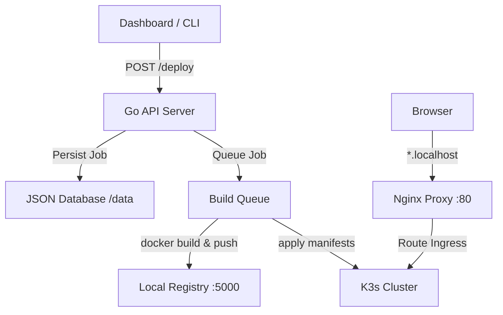

# Deploy Platform 🚀

A self-hosted, zero-dependency developer PaaS (Heroku / Vercel clone). Package your project → auto-build container → deploy to Kubernetes (k3s) → assign automatic `*.localhost` subdomains with real-time diagnostics.

---

## Architecture Flow



---

## ⚡ Key Features

* **📦 Instant Containerization:** Auto-detects `Dockerfile`, builds image, and pushes to local registry.
* **💾 Persistent Config database:** Pure standard-library JSON file-backed database persists job data across restarts.
* **🔑 Environment Variables:** Custom key-value variables dynamically injected into K8s Pod specifications.
* **🩺 Real-Time Diagnostics:** Monitor active Pod phases, container age, and crash restarts directly from the UI.
* **💻 Interactive Console Logs:** Stream runtime `stdout`/`stderr` container logs on-demand.
* **⚙️ Scaling & Lifecycle:** Scale replica instances (0–10) or purge all K8s resources with a single click.
* **🌐 Zero-Config subdomains:** Automatic DNS routing for `http://<app-name>.localhost` out-of-the-box.

---

## 🛠 Tech Stack

| Layer | Technology |
| :--- | :--- |
| **API Backend** | Go 1.22 (Pure standard library, zero external dependencies) |
| **Frontend** | React 18 + Vite (Premium glassmorphic theme & CSS animations) |
| **Orchestrator** | k3s (Lightweight Kubernetes cluster) |
| **Reverse Proxy** | Nginx (Wildcard routing) |
| **Registry** | Docker Registry v2 |
| **Dev Environment** | Docker Compose |

---

## 🚀 Quick Start (WSL2 / Linux)

### 1. Install & Configure Cluster
```bash
# 1. Install dependencies (Docker, Go 1.22, k3s)
chmod +x scripts/install.sh && ./scripts/install.sh

# 2. Reload shell configuration
newgrp docker && source ~/.bashrc
```

### 2. Launch the Platform
```bash
# Start the orchestration stack
chmod +x scripts/start.sh && ./scripts/start.sh
```
* Access the Dashboard: **`http://localhost:5173`**
* Health API check: `http://localhost:8080/health`

### 3. Deploy Your First App
```bash
# Deploy the included sample application
./scripts/deploy-cli.sh hello-world ./sample-app
```

---

## 📂 Project Structure

```
deploy-platform/
├── api/                   Go API Backend (zero external deps)
│   ├── builder/           Job queue, build workers, persistence
│   ├── handlers/          Status, deploy, delete, scale, pods, logs
│   ├── k8s/               K8s API client (pure stdlib)
│   └── models/            DeployJob model
├── frontend/              React Dashboard
│   ├── src/components/    DeployForm, DeployCard, StatusBadge, LogViewer
│   └── src/api/client.js  REST Client
├── nginx/                 Reverse proxy configuration
├── k8s-manifests/         K3s Namespace, Registry, and Ingress manifests
├── scripts/               Installer and CLI tools
└── docker-compose.yml     Local development stack config
```

---

## 📜 API Reference

| Method | Path | Description |
| :--- | :--- | :--- |
| `POST` | `/deploy` | Deploy a ZIP archive |
| `GET` | `/deploy` | List all deployments |
| `GET` | `/deploy/:id` | Get job status & build logs |
| `DELETE` | `/deploy/:id` | Undeploy and purge K8s resources |
| `POST` | `/deploy/:id/scale` | Scale replica instance counts |
| `GET` | `/deploy/:id/pods` | Fetch live Pod status and restarts |
| `GET` | `/deploy/:id/pods/:pod/logs` | Fetch runtime pod stdout/stderr |

---

## ⚖️ License

MIT License. Open-source PaaS for local development.
